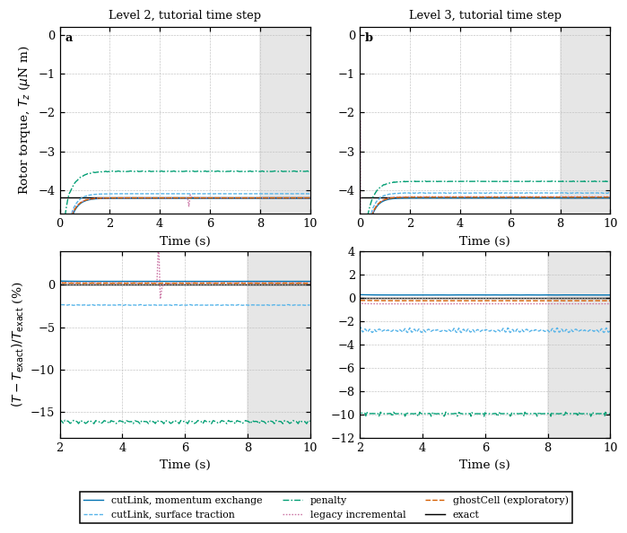
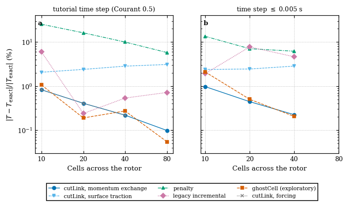
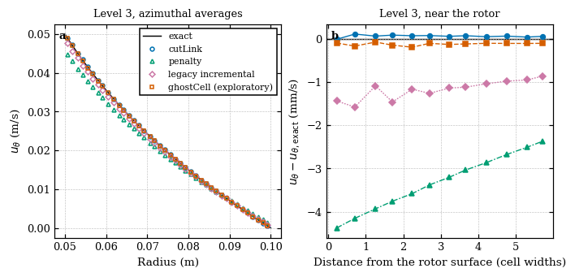
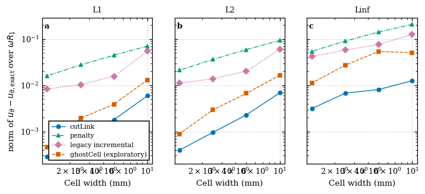
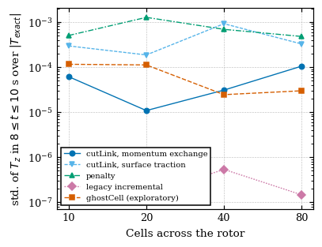
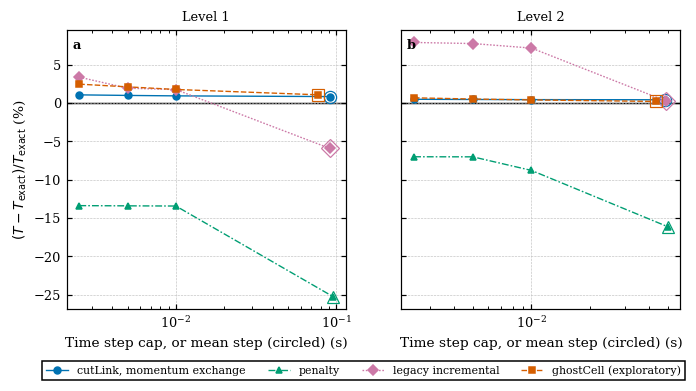
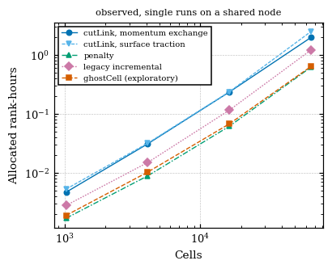

# Results: immersed Taylor-Couette flow against the exact solution

These results come from `./Allverify run --runs matrix L4 dt` (the tracked rows)
and from the control runs of the research workspace named below, with the
baseline `solids4foam` `f33b244a2` built for OpenFOAM.com v2412, whose
`src/immersedBoundary` and tutorial files are identical to those of the
`development` branch used here. The tracked numbers are in `reference/results/`;
every table below is regenerated by `./Allverify tables` (a test compares them
with this file).

## Summary

1. **Exact torque.** The exact torque on the rotor is -4.18879e-6 N m, derived
   from the Navier-Stokes solution, checked against the stress integral and the
   viscous dissipation, and not copied from the README (Section Exact solution).
2. **cutLink, momentum exchange.** The torque is +0.82 %, +0.41 %, +0.22 % and
   +0.10 % from the exact value on Levels 1-4 (10, 20, 40 and 80 cells across
   the rotor), and the azimuthal velocity L2 norm is 6.9e-3, 2.3e-3, 9.6e-4 and
   4.0e-4 of the rotor surface speed omega R1. The `forcing` estimator gives the
   same torque.
3. **cutLink, surface traction.** The torque is -2.06 %, -2.39 %, -2.83 % and
   -3.09 % on Levels 1-4: it does not approach the exact torque on this
   hierarchy, although the flow is the same as that of the momentum exchange and
   the torque computed from the velocity field supports the momentum exchange.
   No cause is claimed.
4. **penalty** is -25.3 %, -16.2 %, -10.0 % and -5.8 % from the exact torque on
   Levels 1-4 at the tutorial step (velocity L2 norm 9.3e-2, 5.9e-2, 3.6e-2 and
   2.1e-2): the effective walls are displaced into the bodies, as the tutorial
   README states (not measured here). The legacy `incremental` method is -5.9 %,
   +0.2 %, -0.5 % and -0.7 %, and `ghostCell` +1.06 %, +0.19 %, -0.27 % and
   -0.05 %.
5. **The tutorial's time step is part of every difference.** The step is limited
   by the Courant number and so halves with each level. With the step capped at
   0.01 s or less, the `penalty` torque difference goes from -25.3 % to -13.4 %
   on Level 1 and from -16.2 % to -7.0 % on Level 2 (the means of the capped
   steps agree within the window uncertainty of about 0.5 points), and the
   legacy `incremental` torque on Level 2 goes from +0.2 % to +7.9 %: the
   apparently good tutorial value is consistent with a cancellation of a spatial
   and a temporal error (neither is converged). `ghostCell` on Levels 1-2 and
   `cutLink` on Level 1 also depend on the step, less strongly (Section Time
   step). The sequence of Levels at the tutorial step is not a spatial
   convergence study, and no formal order is claimed from it.
6. **ghostCell** is exploratory. The rotor surface does not change position in
   the mesh, the ghost-cell set is constant, no ghost cell lacks a donor, and a
   four-rank run with cross-processor donors reproduces the serial result.
7. **Torque reconstruction.** The forcing torque of `penalty`, `incremental` and
   `ghostCell` is the torque on the rotor in the steady state used here (the
   interior fluid rotates rigidly at constant omega, so its angular momentum is
   constant); nothing is added and no estimator is labelled unsupported. The
   torque from the velocity field alone agrees with the force output to 0.7 % or
   better for `cutLink` (momentum exchange), `penalty` and `ghostCell`, but
   differs by 2 to 4 % for the legacy `incremental` method.

## Setup (read from the tutorial files)

<!-- markdownlint-disable MD013 -->

| Quantity | Value | Source |
| -------- | ----- | ------ |
| rotor | solid cylinder, radius 0.05 m (256-gon), `solidBodyRotation` about the origin and the z axis, omega = 1 rad/s | `rotor.stl`, `constant/fvOptions` |
| stator | fixed annulus 0.1 m to 0.25 m | `stator.stl` |
| fluid | nu = 1e-3 m^2/s, rho = 1, Reynolds number omega R1 (R2 - R1)/nu = 2.5 | `constant/transportProperties` |
| mesh | square of side 0.32 m, 32, 64, 128, 256 cells across (10, 20, 40, 80 across the rotor), one cell 0.1 m thick | `blockMeshDict` |
| centre of rotation and torque axis | origin, z (the same for both bodies) | `CofR`, `motion` |
| time | to 10 s, adaptive step with Courant number 0.5 (mean step about 0.09, 0.05, 0.025, 0.013 s on the Levels) | `controlDict` |
| window of the mean | 8 <= t <= 10 s, the same for every method | predefined |

<!-- markdownlint-enable MD013 -->

## Exact solution

For a steady, laminar, axisymmetric flow, the azimuthal velocity is u_theta = A
r + B/r with A = -omega R1^2/(R2^2 - R1^2) and B = omega R1^2 R2^2/(R2^2 -
R1^2), the shear stress is tau = -2 mu B/r^2 (so that r^2 tau is constant), and
the torque of the fluid on the rotor about the axis is

T = 2 pi R1 L_z R1 tau(R1) = -4 pi rho nu omega R1^2 R2^2 L_z/(R2^2 - R1^2) =
-4.18879e-6 N m,

negative because the fluid resists the rotation. The driver reads the radii from
the STL files (rounded to 1e-6 m, the vertices being single-precision numbers),
omega and the axis from `constant/fvOptions`, nu and rho from
`constant/transportProperties` and the thickness from `blockMeshDict`. Tests:
the differential equation by finite differences, tau = mu r d(u/r)/dr, r^2 tau
constant, the torque from the surface stress, the power balance (the torque
times omega equals the viscous dissipation of the gap, to 1e-6), the scalings
and the sign reversal with omega, and the torque of the exact field computed
with the field method of this directory (0.2 % to 0.5 % on Levels 2-3). The
256-gon of the rotor is inscribed in the circle (mean radius lower by 7.5e-5
relative), an effect of the order 1e-4 on the exact torque.

## Results at the tutorial time step

The torque difference is (T - T_exact)/T_exact, so a positive value is a torque
that is too large in magnitude; T is the time-weighted mean over the window and
the standard deviation is that in the window, relative to |T_exact|. "u_theta"
are volume-weighted norms of the azimuthal velocity difference at t = 10 s over
omega R1, in the fluid cells (cell centres in R1 < r < R2); the cells within two
cell widths of a wall are the larger part of the Linf norm and are reported
separately in `reference/results/cases.csv` (`ut_*_far` and `ut_*_iface`). A
case is steady when the relative drift of the torque over the window and the
relative change of the velocity between t = 5 and 10 s are both below 1e-3. The
ranks are 1 (Levels 1-3) and 4 (Level 4, slabs along y); the rank-hours are
allocated ranks times the wall time of the job, observed on a shared node.

<!-- markdownlint-disable MD013 -->

| Method | Level | Cells | Rotor torque (N m) | Exact (N m) | Torque difference | u_theta L1 | u_theta L2 | u_theta Linf | Torque std. (relative) | Steady | Ranks | Rank-h |
| --- | --- | --- | --- | --- | --- | --- | --- | --- | --- | --- | --- | --- |
| cutLink, momentum exchange | 1 | 1024 | -4.2233e-06 | -4.1888e-06 | +0.82 % | 5.95e-03 | 6.87e-03 | 1.26e-02 | 6.1e-05 | yes | 1 | 0.005 |
| cutLink, momentum exchange | 2 | 4096 | -4.2058e-06 | -4.1888e-06 | +0.41 % | 1.81e-03 | 2.29e-03 | 8.11e-03 | 1.1e-05 | yes | 1 | 0.031 |
| cutLink, momentum exchange | 3 | 16384 | -4.1979e-06 | -4.1888e-06 | +0.22 % | 6.70e-04 | 9.58e-04 | 6.75e-03 | 3.1e-05 | yes | 1 | 0.235 |
| cutLink, momentum exchange | 4 | 65536 | -4.1929e-06 | -4.1888e-06 | +0.10 % | 2.82e-04 | 3.96e-04 | 3.14e-03 | 1.0e-04 | yes | 4 | 1.983 |
| cutLink, surface traction | 1 | 1024 | -4.1024e-06 | -4.1888e-06 | -2.06 % | 5.95e-03 | 6.87e-03 | 1.26e-02 | 2.9e-04 | yes | 1 | 0.005 |
| cutLink, surface traction | 2 | 4096 | -4.0888e-06 | -4.1888e-06 | -2.39 % | 1.81e-03 | 2.29e-03 | 8.11e-03 | 1.9e-04 | yes | 1 | 0.032 |
| cutLink, surface traction | 3 | 16384 | -4.0701e-06 | -4.1888e-06 | -2.83 % | 6.70e-04 | 9.58e-04 | 6.75e-03 | 9.2e-04 | yes | 1 | 0.237 |
| cutLink, surface traction | 4 | 65536 | -4.0595e-06 | -4.1888e-06 | -3.09 % | 2.82e-04 | 3.96e-04 | 3.14e-03 | 3.3e-04 | yes | 4 | 2.500 |
| cutLink, forcing | 1 | 1024 | -4.2233e-06 | -4.1888e-06 | +0.82 % | 5.95e-03 | 6.87e-03 | 1.26e-02 | 6.5e-05 | yes | 1 | 0.005 |
| cutLink, forcing | 2 | 4096 | -4.2058e-06 | -4.1888e-06 | +0.41 % | 1.81e-03 | 2.29e-03 | 8.11e-03 | 1.0e-05 | yes | 1 | 0.031 |
| cutLink, forcing | 3 | 16384 | -4.1979e-06 | -4.1888e-06 | +0.22 % | 6.70e-04 | 9.58e-04 | 6.75e-03 | 3.3e-05 | yes | 1 | 0.243 |
| penalty | 1 | 1024 | -3.1304e-06 | -4.1888e-06 | -25.27 % | 7.07e-02 | 9.33e-02 | 2.07e-01 | 5.0e-04 | no | 1 | 0.002 |
| penalty | 2 | 4096 | -3.5122e-06 | -4.1888e-06 | -16.15 % | 4.49e-02 | 5.92e-02 | 1.42e-01 | 1.3e-03 | yes | 1 | 0.009 |
| penalty | 3 | 16384 | -3.7714e-06 | -4.1888e-06 | -9.96 % | 2.76e-02 | 3.63e-02 | 9.07e-02 | 6.9e-04 | yes | 1 | 0.062 |
| penalty | 4 | 65536 | -3.9473e-06 | -4.1888e-06 | -5.76 % | 1.60e-02 | 2.11e-02 | 5.43e-02 | 4.8e-04 | yes | 4 | 0.621 |
| incremental | 1 | 1024 | -3.9402e-06 | -4.1888e-06 | -5.93 % | 5.46e-02 | 6.04e-02 | 1.26e-01 | 1.1e-07 | yes | 1 | 0.003 |
| incremental | 2 | 4096 | -4.1988e-06 | -4.1888e-06 | +0.24 % | 1.57e-02 | 2.01e-02 | 7.63e-02 | 1.4e-07 | yes | 1 | 0.015 |
| incremental | 3 | 16384 | -4.1664e-06 | -4.1888e-06 | -0.54 % | 1.03e-02 | 1.39e-02 | 5.81e-02 | 5.3e-07 | yes | 1 | 0.116 |
| incremental | 4 | 65536 | -4.1588e-06 | -4.1888e-06 | -0.72 % | 8.31e-03 | 1.11e-02 | 4.18e-02 | 1.4e-07 | yes | 4 | 1.214 |
| ghostCell (exploratory) | 1 | 1024 | -4.2331e-06 | -4.1888e-06 | +1.06 % | 1.31e-02 | 1.65e-02 | 5.06e-02 | 1.2e-04 | yes | 1 | 0.002 |
| ghostCell (exploratory) | 2 | 4096 | -4.1967e-06 | -4.1888e-06 | +0.19 % | 3.91e-03 | 6.67e-03 | 5.40e-02 | 1.1e-04 | yes | 1 | 0.010 |
| ghostCell (exploratory) | 3 | 16384 | -4.1774e-06 | -4.1888e-06 | -0.27 % | 1.93e-03 | 2.94e-03 | 2.73e-02 | 2.4e-05 | yes | 1 | 0.068 |
| ghostCell (exploratory) | 4 | 65536 | -4.1865e-06 | -4.1888e-06 | -0.05 % | 4.66e-04 | 8.92e-04 | 1.12e-02 | 3.0e-05 | yes | 4 | 0.639 |

<!-- markdownlint-enable MD013 -->

Reading of the table:

- All rows are steady by the predefined criteria except `penalty` on Level 1
  (endpoint drift 1.5e-3 against 1e-3; the criterion compares the two end values
  of the window, so it also responds to oscillation, and the flag is not robust
  near the threshold: the surface traction on Level 3 is at 9.6e-4): its mean
  and standard deviation are reported and it is not called converged. The
  relative standard deviation of the torque in the window is 5e-4 to 1.3e-3 for
  `penalty` and 2e-4 to 9e-4 for the surface traction, 1e-5 to 1e-4 for the
  momentum exchange, 2e-5 to 1e-4 for `ghostCell` and 1e-7 for `incremental`.
- The velocity norms of the three `cutLink` rows are equal: they are one flow
  (one run each, the torque column being the estimator selected in that run).
  The momentum exchange and the `forcing` estimate give the same torque to the
  digits shown (the rigid-body term of the latter is zero for a centred
  rotation).
- The Linf norm of `ghostCell` is dominated by cells next to the wall (0.05 of
  omega R1 on Levels 1-2, 0.027 and 0.011 on Levels 3-4); the L2 norm decreases
  from 1.7e-2 to 8.9e-4.
- The README of the tutorial gives +0.8 %, +0.3 %, +0.2 % and -25 %, -16 %, -10
  % for `cutLink` and `penalty` on Levels 1-3; the values here are +0.82 %,
  +0.41 %, +0.22 % and -25.3 %, -16.2 %, -10.0 %, and its velocity norms 7.2e-3,
  2.3e-3, 9.8e-4 (RMS over the gap) and 9.4e-2, 5.9e-2, 3.6e-2 are 6.9e-3,
  2.3e-3, 9.6e-4 and 9.3e-2, 5.9e-2, 3.6e-2 here: the results reproduce.

## Time step

The tutorial's step is limited by the Courant number and so halves with each
level (mean step about 0.09, 0.05, 0.025 and 0.013 s), which makes the mesh
levels a study of space and time together. The control caps the step with
`maxDeltaT` (0.01, 0.005 and 0.0025 s). The cells give the torque difference and
the velocity L2 norm.

<!-- markdownlint-disable MD013 -->

| Method | Level | tutorial step | cap 0.01 s | cap 0.005 s | cap 0.0025 s |
| --- | --- | --- | --- | --- | --- |
| cutLink, momentum exchange | 1 | +0.82 % / 6.87e-03 | +0.91 % / 7.56e-03 | +0.97 % / 7.98e-03 | +1.05 % / 8.51e-03 |
| cutLink, momentum exchange | 2 | +0.41 % / 2.29e-03 | +0.42 % / 2.40e-03 | +0.44 % / 2.51e-03 | +0.47 % / 2.69e-03 |
| cutLink, momentum exchange | 3 | +0.22 % / 9.58e-04 | +0.22 % / 9.69e-04 | +0.22 % / 9.85e-04 | n/a |
| cutLink, surface traction | 1 | -2.06 % / 6.87e-03 | -2.26 % / 7.56e-03 | -2.38 % / 7.98e-03 | -2.54 % / 8.51e-03 |
| cutLink, surface traction | 2 | -2.39 % / 2.29e-03 | -2.41 % / 2.40e-03 | -2.44 % / 2.51e-03 | -2.48 % / 2.69e-03 |
| cutLink, surface traction | 3 | -2.83 % / 9.58e-04 | -2.84 % / 9.69e-04 | -2.84 % / 9.85e-04 | n/a |
| penalty | 1 | -25.27 % / 9.33e-02 * | -13.46 % / 4.85e-02 * | -13.43 % / 4.84e-02 * | -13.40 % / 4.83e-02 * |
| penalty | 2 | -16.15 % / 5.92e-02 | -8.81 % / 3.26e-02 * | -7.04 % / 2.58e-02 * | -7.03 % / 2.58e-02 * |
| penalty | 3 | -9.96 % / 3.63e-02 | -7.93 % / 2.88e-02 * | -6.18 % / 2.25e-02 | n/a |
| incremental | 1 | -5.93 % / 6.04e-02 | +1.73 % / 5.35e-02 * | +1.92 % / 5.45e-02 * | +3.35 % / 5.10e-02 * |
| incremental | 2 | +0.24 % / 2.01e-02 | +7.15 % / 2.16e-02 | +7.74 % / 2.53e-02 | +7.88 % / 2.72e-02 * |
| incremental | 3 | -0.54 % / 1.39e-02 | +3.04 % / 6.48e-03 | +4.62 % / 7.90e-03 | n/a |
| ghostCell (exploratory) | 1 | +1.06 % / 1.65e-02 | +1.75 % / 2.00e-02 * | +2.09 % / 2.16e-02 * | +2.44 % / 2.33e-02 |
| ghostCell (exploratory) | 2 | +0.19 % / 6.67e-03 | +0.39 % / 7.53e-03 | +0.50 % / 8.14e-03 | +0.66 % / 9.00e-03 |
| ghostCell (exploratory) | 3 | -0.27 % / 2.94e-03 | -0.23 % / 3.01e-03 | -0.20 % / 3.07e-03 | n/a |

<!-- markdownlint-enable MD013 -->

- `penalty`: at a capped step the torque difference no longer changes with the
  step (Level 1: -13.46 %, -13.43 %, -13.40 %; Level 2: -8.81 %, -7.04 %, -7.03
  %). Level 3 (-9.96 % at the tutorial step, -7.9 % at 0.01 s, -6.2 % at 0.005
  s) is not yet converged in the step. At converged steps the torque differences
  on Levels 1 and 2 are -13.4 % and -7.0 %, a ratio of 1.9; the tutorial values
  -25.3 % and -16.2 % contain a time error of 12 and 9 percentage points. This
  is two levels, not an order. With a capped step most `penalty` runs are not
  steady by the predefined criteria (endpoint drift of 4e-3 to 8e-3 on Level 1
  and Level 2, which moves the mean over the window by about 0.5 percentage
  points): the means are window-dependent at that level, the differences between
  the capped steps (0.03 points) are below it, and "converged in the step" means
  that the means are the same within the window uncertainty. Non-steady cells of
  the table are marked with an asterisk.
- `incremental`: the torque difference at a capped step is positive and keeps
  changing with the step (Level 2: +7.2 %, +7.7 %, +7.9 %; Level 1: +1.7 %, +1.9
  %, +3.4 %; Level 3: +3.0 %, +4.6 %), whereas the tutorial value is +0.24 % on
  Level 2: it is consistent with a cancellation of a spatial error and a
  temporal error (neither is isolated). The method's documentation says that its
  results depend on the step.
- `ghostCell`: the torque difference grows as the step is reduced on Levels 1-2
  (Level 1: +1.06 % at the tutorial step, then +1.75 %, +2.09 %, +2.44 %; Level
  2: +0.19 %, +0.39 %, +0.50 %, +0.66 %) and hardly changes on Level 3 (-0.27 %,
  -0.23 %, -0.20 %), the documentation stating that the results do not depend on
  the step.
- `cutLink`: the momentum exchange changes by 0.2 percentage points on Level 1
  between the tutorial step and 0.0025 s (+0.82 % to +1.05 %), by 0.06 on Level
  2 and not at all on Level 3 (+0.22 % at every step); the velocity norm on
  Level 1 grows from 6.9e-3 to 8.5e-3. The surface traction moves the same way
  on Level 1 (-2.06 % to -2.54 %) and is -2.84 % at every step on Level 3: its
  departure from the exact torque is not a time-step effect.

## Torque reconstruction

The force output of `penalty`, `incremental` and `ghostCell` is the forcing and
its torque is -rho sum((C - CofR) x f V) over the cells of the body; the inertia
column is the linear momentum only. The hydrodynamic torque is that forcing
torque plus the rate of change of the angular momentum of the fluid inside the
body; in the steady state used here the interior rotates rigidly at constant
omega, the second term vanishes, and nothing is added. The sign was checked
independently: the torque on the rotor is negative, of the exact magnitude
within 1 %. The torque from the velocity field alone (the viscous torque
transmitted across five circles in the gap) is reported in the column
`T_field_rel` of `cases.csv`; it agrees with the force output to 0.7 % or better
for the `cutLink` momentum exchange, the `penalty` and `ghostCell` methods on
every level, supports the momentum exchange against the surface traction (which
differs from it by 3 to 4 percentage points), and differs by 2 to 4 % for the
legacy `incremental` method (on Level 2: forcing torque +0.2 %, field torque
-3.2 %), for which the forcing torque is therefore not the torque transmitted
through the fluid. The torque on the stator, which should be equal and opposite
(in the capped-step runs the sums reach 4.3 times (`ghostCell`) and 1.2 times
(`incremental`) the exact torque, and so their stator torque is not meaningful),
is reported (`T_stator_balance`) but not used: relative to the exact torque, the
sum of the two torques is 0.4-1.6 % for the `cutLink` surface traction, 5-8 %
for its momentum exchange, 7-10 % for `penalty`, 20-43 % for `incremental` and
between +1 % and -39 % without a trend for `ghostCell`; the estimators sum the
forcing of a 0.15 m wide annulus and may not be suited to it (not tested; the
rotor is the quantity of the benchmark).

## ghostCell: applicability and parallel behaviour

The rotor turns about its own axis. Its surface (a 256-gon whose sagitta is
about 0.04 % of a Level 1 cell) does not change position in the mesh, so the
occupancy, the ghost cells and the donors are the same at all times: the logs
show a constant number of ghost cells at every step (88, 172, 340 and 680 on
Levels 1-4), none without a donor, and no cell that the body leaves. The target
velocity of the ghost cells is extrapolated through the body velocity at the
nearest surface point, here omega x r, evaluated at every step. The documented
restriction to static bodies concerns the cells that a moving body leaves (fresh
cells), which do not occur here. The method is therefore applied, but as
exploratory: its time-step dependence contradicts its documentation, the
interface-cell velocity error does not decrease monotonically, and the torque
changes sign between Levels 2 and 3.

Parallel: Level 2 on four ranks, decomposed in slabs along y (16 ghost cells
with a donor on another processor; 12 on Level 4), reproduces the serial torque
and velocity norms of `ghostCell` and `penalty` to all digits tabulated
(research workspace, `*-np4-mpiy`). A decomposition along x stops the run in
`setRefCell` because the pressure reference point of the tutorial lies on the
plane x = 0 (the five failed Level 4 runs and two failed controls with this
decomposition were kept).

## Cost

The wall time and allocated rank-hours of the tutorial runs are in the master
table. Observed, single runs on a shared node (Levels 1-3 serial, Level 4 on
four ranks); the ranking of the methods and the increase with the number of
cells are observations of these runs, not intrinsic efficiencies. The wall time
of a `cutLink` run is 3.2 to 4 times that of `penalty` on every level (17 s and
5 s on Level 1, 846 s and 221 s on Level 3, 1,781 s and 555 s on Level 4 for the
momentum exchange). The first attempt at the `cutLink` momentum-exchange run on
Level 4 ran at a fifth of that speed on cores of both sockets of the node and
was cancelled and repeated on one socket (`--ntasks-per-socket`); the cancelled
run is kept in the research workspace and counted in its ledger. Scaling of the
Level 4 `penalty` case over the first 1.5 s: 1 rank: 328 s (100 % efficiency); 2
ranks: 161 s (102 % efficiency); 4 ranks: 90 s (91 % efficiency); 8 ranks: 59 s
(69 % efficiency), for 126 time steps (`reference/results/scaling.csv`).

## Limitations

- Single runs; costs observed on a shared node.
- The sequence of Levels at the tutorial step contains time error (Section Time
  step); no formal order is claimed, and the capped-step runs reach only 0.005 s
  on Level 3 and 0.0025 s on Levels 1-2 (not converged in the step for
  `incremental`, `ghostCell` on Levels 1-2 and `penalty` on Level 3).
- The torque of `penalty`, `incremental` and `ghostCell` is the forcing torque,
  equal to the torque on the rotor only in the steady state.
- The stator torque of the `cutLink` momentum exchange is 5-8 % low while the
  rotor torque is within 1 %; this estimator inconsistency is not explained.
- The surface-traction torque of `cutLink` does not converge on this hierarchy
  and its cause is not identified.
- The velocity is compared at the cell centres with the exact point values, not
  with cell averages (a second-order difference).
- `ghostCell` is exploratory and was run on this case with an invariant surface
  only.
- The reported results contain no filtering or shifting.
