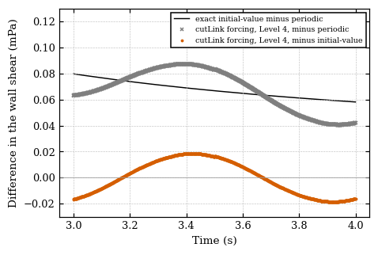
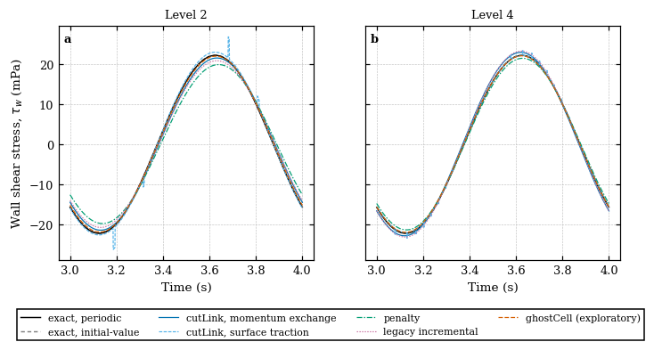
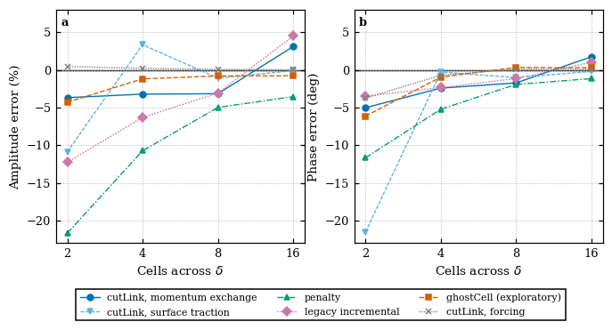
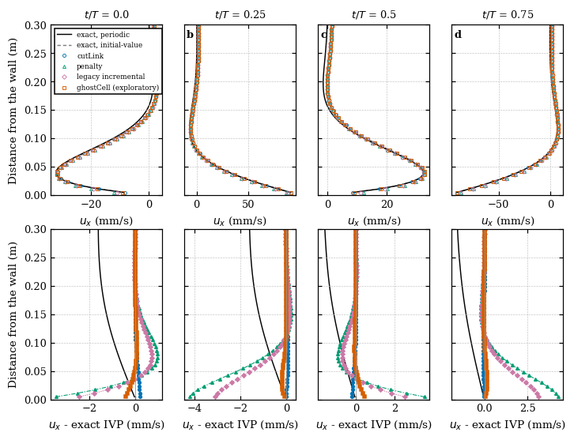
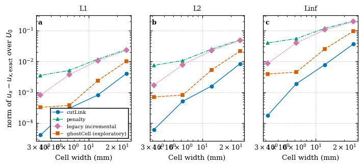
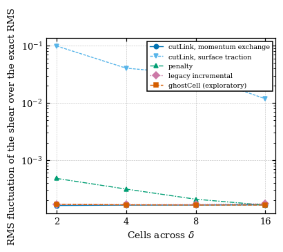
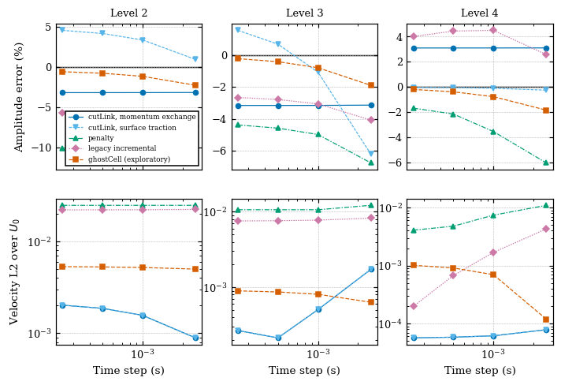
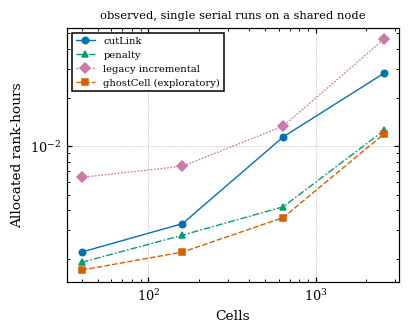

# Results: oscillating-wall Stokes layer against the exact solution

These results come from `./Allverify run --runs matrix dt` (and the control runs
of the research workspace listed under Controls), with the baseline
`solids4foam` `f33b244a2` built for OpenFOAM.com v2412, whose
`src/immersedBoundary` and tutorial files are identical to those of the
`development` branch used here. The tracked numbers are in `reference/results/`;
every table below is regenerated by `./Allverify tables` (a test compares them
with this file).

## Summary

1. **The fourth period is not periodic.** The simulation starts from rest, and
   the exact solution of that problem (with the slip lid of the mesh) differs
   from the periodic Stokes solution in the fourth period by 0.43 % of the RMS
   wall shear and by about 1 % of U0 in the velocity. The numerical solutions
   follow the exact initial-value solution (errors against it converge; against
   the periodic solution they stall at 1.2e-2 of U0 for every method). Both
   exact solutions are reported; the periodic solution is never altered.
2. **Velocity.** Against the exact initial-value solution, the L2 norm of the
   `cutLink` velocity is 8.4e-3, 1.6e-3, 5.1e-4 and 6.2e-5 of U0 on Levels 1-4
   (the tutorial step); `ghostCell` 2.2e-2, 5.2e-3, 8.1e-4 and 7.0e-4; `penalty`
   5.0e-2, 2.5e-2, 1.1e-2 and 7.4e-3; the legacy `incremental` method 4.8e-2,
   2.2e-2, 7.7e-3 and 1.7e-3. The velocity of `penalty` and `incremental` also
   depends on the time step (Section Time step), and that of `ghostCell` stalls
   near 1e-3 of U0.
3. **Wall shear.** Which number is reported depends on the estimator. `cutLink`
   with the `forcing` estimator gives the exact amplitude to 0.44 %, 0.18 %,
   0.05 % and 0.0002 % (periodic target), but its phase error on Level 1 is -3.7
   degrees and its RMS error 6.6 %: an accurate amplitude does not make an
   accurate history. The momentum exchange of `cutLink` is 3.7 %, 3.2 %, 3.2 %
   low, then 3.1 % high on Levels 1-4; it does not converge, because the
   interior inertia it contains is 3.5 times the shear amplitude (Section Shear
   estimators). The surface traction is noisy on the coarse meshes and 0.13 %
   low on Level 4. `penalty` is 21.7 %, 10.7 %, 5.0 % and 3.6 % low, the legacy
   `incremental` method 12.3 %, 6.3 %, 3.1 % low and 4.5 % high, `ghostCell` 4.3
   %, 1.2 %, 0.8 % and 0.8 % low.
4. **Time step.** Reducing the step at fixed mesh changes the `penalty`
   amplitude error on Level 4 from -3.5 % to -1.7 % and the legacy `incremental`
   velocity error on Level 4 by a factor 8. For these methods the time step is
   as important as the mesh on the finer levels; the tutorial's fixed step
   (0.001 s) does not isolate the spatial error.
5. **ghostCell** is run as an exploratory method. Its ghost-cell set is constant
   in time, there are no fresh cells, no ghost cell lacks a donor, and a
   four-rank run with cross-processor donors reproduces the serial result to all
   printed digits.
6. **Cost.** 5 to 165 s per case in serial (Section Cost); observed on a shared
   node, not an intrinsic efficiency.

## Setup (read from the tutorial files)

<!-- markdownlint-disable MD013 -->

| Quantity | Value | Source |
| -------- | ----- | ------ |
| viscosity, density | 0.00785398 m^2/s, 1 | `constant/transportProperties` |
| slab velocity | U0 sin(omega t), U0 = 0.1 m/s, omega = 2 pi | `sinusoidalTranslation`: amplitude 0.0159154943 m, period 1 s, phase -pi/2 |
| Stokes thickness | delta = sqrt(2 nu/omega) = 0.05 m | derived |
| wall | y_w = 0.1234 m (top face of `slab.stl`) | surface |
| mesh | 0.5 m high with 20, 40, 80, 160 cells (40, 160, 640, 2560 cells in all), cyclic length 0.05 m, depth 0.1 m | `blockMeshDict` |
| lid | slip at y = 0.5 m, i.e. 7.5 delta above the wall | `0/U` |
| time | 4 periods, 0.001 s, `backward` | `controlDict`, `fvSchemes` |
| wall area of the force | 0.005 m^2 on every level | lx * depth |

<!-- markdownlint-enable MD013 -->

## Exact solutions

Derived in the research report and tested in the unit tests (PDE residual by
finite differences, boundary values, tau = rho nu du/ds at the wall, the
amplitude and phase of the shear, the finite-height solution, the modal series).

- Periodic: u = U0 exp(-s/delta) sin(omega t - s/delta), s = y - y_w; shear
  stress of the fluid on the wall tau_w = -rho nu U0/delta (sin omega t + cos
  omega t), amplitude 0.0222144 Pa for rho = 1.
- With the lid at s = H = 0.3766 m: the shear amplitude differs from the
  half-space value by 8e-7 relative; the lid is negligible for the periodic
  solution.
- Initial-value problem: the fluid and the slab are at rest at t = 0, the slab
  velocity being U0 sin(omega t). The exact solution is the periodic solution
  with the lid plus a series of the lid modes sin(k_n s), k_n = (n + 1/2) pi/H,
  which decay as exp(-nu k_n^2 t); the slowest has nu k_1^2 = 0.137 1/s. Over
  the fourth period the transient is 0.43 % of the RMS shear and 1.2e-2 of U0 in
  the velocity (RMS over the fluid cells), and decays slowly: the RMS shear
  difference is 0.43 %, 0.21 %, 0.12 % and 0.07 % of the RMS shear at the ends
  of periods 4, 8, 12 and 16 (velocity 1.2e-2, 7.0e-3, 4.0e-3 and 2.3e-3 of U0).
  Extending the runs would therefore reduce the transient only slowly: it would
  take about 24 periods (6 times the cost) to bring it to 0.02 %, and the exact
  initial-value solution already gives the exact target for the four-period
  protocol of the tutorial, so the runs are not extended. A control to eight
  periods (cutLink and penalty, Level 3, research workspace) gives the same
  errors against the initial-value solution in the fourth and in the eighth
  period (to 0.01 % of the amplitude), so the numerical solution follows it.

## Results at the tutorial time step

Errors against the periodic solution (the official target). Amplitude and phase
are those of the fitted fundamental; the RMS error is that of the whole time
history; "u" are volume-weighted norms of the velocity over U0 in the fluid
cells (over the eight snapshots of the fourth period); "Noise" is the RMS
fluctuation of the shear about its mean and three harmonics, relative to the
exact RMS. The ranks are 1 and the rank-hours are allocated ranks times the wall
time of the job.

<!-- markdownlint-disable MD013 -->

| Method | Level | Cells | Exact shear amplitude (Pa) | Computed amplitude (Pa) | Amplitude error | Phase error (deg) | Shear RMS error | u L1 | u L2 | u Linf | Noise | Ranks | Rank-h |
| --- | --- | --- | --- | --- | --- | --- | --- | --- | --- | --- | --- | --- | --- |
| cutLink, momentum exchange | 1 | 40 | 2.2214e-02 | 2.1391e-02 | -3.70 % | -5.00 | 9.34 % | 1.35e-02 | 1.47e-02 | 3.81e-02 | 1.6e-04 | 1 | 0.0022 |
| cutLink, momentum exchange | 2 | 160 | 2.2214e-02 | 2.1495e-02 | -3.24 % | -2.41 | 5.26 % | 1.14e-02 | 1.22e-02 | 1.65e-02 | 1.6e-04 | 1 | 0.0033 |
| cutLink, momentum exchange | 3 | 640 | 2.2214e-02 | 2.1508e-02 | -3.18 % | -1.71 | 4.35 % | 1.11e-02 | 1.21e-02 | 1.66e-02 | 1.6e-04 | 1 | 0.0114 |
| cutLink, momentum exchange | 4 | 2560 | 2.2214e-02 | 2.2898e-02 | +3.08 % | +1.76 | 4.40 % | 1.10e-02 | 1.20e-02 | 1.66e-02 | 1.7e-04 | 1 | 0.0283 |
| cutLink, surface traction | 1 | 40 | 2.2214e-02 | 1.9796e-02 | -10.89 % | -21.51 | 38.33 % | 1.35e-02 | 1.47e-02 | 3.81e-02 | 9.9e-02 | 1 | 0.0022 |
| cutLink, surface traction | 2 | 160 | 2.2214e-02 | 2.2951e-02 | +3.32 % | -0.27 | 5.34 % | 1.14e-02 | 1.22e-02 | 1.65e-02 | 4.1e-02 | 1 | 0.0033 |
| cutLink, surface traction | 3 | 640 | 2.2214e-02 | 2.1970e-02 | -1.10 % | -1.00 | 3.82 % | 1.11e-02 | 1.21e-02 | 1.66e-02 | 3.2e-02 | 1 | 0.0114 |
| cutLink, surface traction | 4 | 2560 | 2.2214e-02 | 2.2186e-02 | -0.13 % | -0.20 | 1.32 % | 1.10e-02 | 1.20e-02 | 1.66e-02 | 1.2e-02 | 1 | 0.0283 |
| cutLink, forcing | 1 | 40 | 2.2214e-02 | 2.2311e-02 | +0.44 % | -3.73 | 6.56 % | 1.35e-02 | 1.47e-02 | 3.81e-02 | 2.8e-03 | 1 | 0.0025 |
| cutLink, forcing | 2 | 160 | 2.2214e-02 | 2.2254e-02 | +0.18 % | -0.70 | 1.30 % | 1.14e-02 | 1.22e-02 | 1.65e-02 | 3.0e-04 | 1 | 0.0033 |
| cutLink, forcing | 3 | 640 | 2.2214e-02 | 2.2226e-02 | +0.05 % | +0.12 | 0.49 % | 1.11e-02 | 1.21e-02 | 1.66e-02 | 1.4e-04 | 1 | 0.0108 |
| cutLink, forcing | 4 | 2560 | 2.2214e-02 | 2.2215e-02 | +0.00 % | +0.06 | 0.44 % | 1.10e-02 | 1.20e-02 | 1.66e-02 | 1.6e-04 | 1 | 0.0278 |
| penalty | 1 | 40 | 2.2214e-02 | 1.7398e-02 | -21.68 % | -11.65 | 28.16 % | 3.14e-02 | 5.12e-02 | 2.05e-01 | 4.8e-04 | 1 | 0.0019 |
| penalty | 2 | 160 | 2.2214e-02 | 1.9827e-02 | -10.75 % | -5.20 | 13.76 % | 2.03e-02 | 2.75e-02 | 1.19e-01 | 3.1e-04 | 1 | 0.0028 |
| penalty | 3 | 640 | 2.2214e-02 | 2.1103e-02 | -5.00 % | -1.91 | 5.98 % | 1.45e-02 | 1.60e-02 | 5.51e-02 | 2.1e-04 | 1 | 0.0042 |
| penalty | 4 | 2560 | 2.2214e-02 | 2.1422e-02 | -3.57 % | -1.14 | 4.09 % | 1.32e-02 | 1.41e-02 | 3.96e-02 | 1.6e-04 | 1 | 0.0125 |
| incremental | 1 | 40 | 2.2214e-02 | 1.9485e-02 | -12.28 % | -3.47 | 13.54 % | 3.04e-02 | 4.90e-02 | 1.96e-01 | 1.7e-04 | 1 | 0.0064 |
| incremental | 2 | 160 | 2.2214e-02 | 2.0809e-02 | -6.33 % | -2.33 | 7.47 % | 1.92e-02 | 2.51e-02 | 1.06e-01 | 1.7e-04 | 1 | 0.0075 |
| incremental | 3 | 640 | 2.2214e-02 | 2.1528e-02 | -3.09 % | -1.13 | 3.68 % | 1.33e-02 | 1.43e-02 | 4.02e-02 | 1.7e-04 | 1 | 0.0133 |
| incremental | 4 | 2560 | 2.2214e-02 | 2.3209e-02 | +4.48 % | +1.03 | 4.86 % | 1.13e-02 | 1.22e-02 | 1.66e-02 | 1.7e-04 | 1 | 0.0461 |
| ghostCell (exploratory) | 1 | 40 | 2.2214e-02 | 2.1257e-02 | -4.31 % | -6.12 | 11.31 % | 1.89e-02 | 2.47e-02 | 9.71e-02 | 1.7e-04 | 1 | 0.0017 |
| ghostCell (exploratory) | 2 | 160 | 2.2214e-02 | 2.1946e-02 | -1.21 % | -0.94 | 2.07 % | 1.24e-02 | 1.32e-02 | 2.60e-02 | 1.7e-04 | 1 | 0.0022 |
| ghostCell (exploratory) | 3 | 640 | 2.2214e-02 | 2.2031e-02 | -0.82 % | +0.34 | 1.10 % | 1.12e-02 | 1.21e-02 | 1.66e-02 | 1.6e-04 | 1 | 0.0036 |
| ghostCell (exploratory) | 4 | 2560 | 2.2214e-02 | 2.2038e-02 | -0.79 % | +0.29 | 1.03 % | 1.11e-02 | 1.21e-02 | 1.66e-02 | 1.6e-04 | 1 | 0.0119 |

<!-- markdownlint-enable MD013 -->

The same rows against the exact solution of the simulated problem (initial
value, fluid at rest):

<!-- markdownlint-disable MD013 -->

| Method | Level | Cells | Exact shear amplitude (Pa) | Computed amplitude (Pa) | Amplitude error | Phase error (deg) | Shear RMS error | u L1 | u L2 | u Linf | Noise | Ranks | Rank-h |
| --- | --- | --- | --- | --- | --- | --- | --- | --- | --- | --- | --- | --- | --- |
| cutLink, momentum exchange | 1 | 40 | 2.2214e-02 | 2.1391e-02 | -3.68 % | -5.01 | 9.34 % | 4.08e-03 | 8.35e-03 | 3.69e-02 | 1.6e-04 | 1 | 0.0022 |
| cutLink, momentum exchange | 2 | 160 | 2.2214e-02 | 2.1495e-02 | -3.21 % | -2.42 | 5.25 % | 8.08e-04 | 1.57e-03 | 7.84e-03 | 1.6e-04 | 1 | 0.0033 |
| cutLink, momentum exchange | 3 | 640 | 2.2214e-02 | 2.1508e-02 | -3.16 % | -1.72 | 4.33 % | 3.00e-04 | 5.07e-04 | 1.87e-03 | 1.6e-04 | 1 | 0.0114 |
| cutLink, momentum exchange | 4 | 2560 | 2.2214e-02 | 2.2898e-02 | +3.10 % | +1.75 | 4.38 % | 4.06e-05 | 6.16e-05 | 1.76e-04 | 1.7e-04 | 1 | 0.0283 |
| cutLink, surface traction | 1 | 40 | 2.2214e-02 | 1.9796e-02 | -10.87 % | -21.52 | 38.34 % | 4.08e-03 | 8.35e-03 | 3.69e-02 | 9.9e-02 | 1 | 0.0022 |
| cutLink, surface traction | 2 | 160 | 2.2214e-02 | 2.2951e-02 | +3.34 % | -0.28 | 5.32 % | 8.08e-04 | 1.57e-03 | 7.84e-03 | 4.1e-02 | 1 | 0.0033 |
| cutLink, surface traction | 3 | 640 | 2.2214e-02 | 2.1970e-02 | -1.08 % | -1.01 | 3.81 % | 3.00e-04 | 5.07e-04 | 1.87e-03 | 3.2e-02 | 1 | 0.0114 |
| cutLink, surface traction | 4 | 2560 | 2.2214e-02 | 2.2186e-02 | -0.10 % | -0.21 | 1.25 % | 4.06e-05 | 6.16e-05 | 1.76e-04 | 1.2e-02 | 1 | 0.0283 |
| cutLink, forcing | 1 | 40 | 2.2214e-02 | 2.2311e-02 | +0.46 % | -3.74 | 6.57 % | 4.08e-03 | 8.35e-03 | 3.69e-02 | 2.8e-03 | 1 | 0.0025 |
| cutLink, forcing | 2 | 160 | 2.2214e-02 | 2.2254e-02 | +0.20 % | -0.71 | 1.25 % | 8.08e-04 | 1.57e-03 | 7.84e-03 | 3.0e-04 | 1 | 0.0033 |
| cutLink, forcing | 3 | 640 | 2.2214e-02 | 2.2226e-02 | +0.08 % | +0.11 | 0.21 % | 3.00e-04 | 5.07e-04 | 1.87e-03 | 1.4e-04 | 1 | 0.0108 |
| cutLink, forcing | 4 | 2560 | 2.2214e-02 | 2.2215e-02 | +0.02 % | +0.05 | 0.08 % | 4.06e-05 | 6.16e-05 | 1.76e-04 | 1.6e-04 | 1 | 0.0278 |
| penalty | 1 | 40 | 2.2214e-02 | 1.7398e-02 | -21.66 % | -11.66 | 28.16 % | 2.41e-02 | 4.98e-02 | 2.04e-01 | 4.8e-04 | 1 | 0.0019 |
| penalty | 2 | 160 | 2.2214e-02 | 1.9827e-02 | -10.73 % | -5.21 | 13.74 % | 1.18e-02 | 2.48e-02 | 1.18e-01 | 3.1e-04 | 1 | 0.0028 |
| penalty | 3 | 640 | 2.2214e-02 | 2.1103e-02 | -4.98 % | -1.92 | 5.95 % | 5.07e-03 | 1.06e-02 | 5.47e-02 | 2.1e-04 | 1 | 0.0042 |
| penalty | 4 | 2560 | 2.2214e-02 | 2.1422e-02 | -3.54 % | -1.15 | 4.06 % | 3.52e-03 | 7.42e-03 | 3.96e-02 | 1.6e-04 | 1 | 0.0125 |
| incremental | 1 | 40 | 2.2214e-02 | 1.9485e-02 | -12.26 % | -3.48 | 13.52 % | 2.30e-02 | 4.76e-02 | 1.95e-01 | 1.7e-04 | 1 | 0.0064 |
| incremental | 2 | 160 | 2.2214e-02 | 2.0809e-02 | -6.30 % | -2.34 | 7.44 % | 1.06e-02 | 2.22e-02 | 1.06e-01 | 1.7e-04 | 1 | 0.0075 |
| incremental | 3 | 640 | 2.2214e-02 | 2.1528e-02 | -3.06 % | -1.14 | 3.64 % | 3.70e-03 | 7.75e-03 | 3.98e-02 | 1.7e-04 | 1 | 0.0133 |
| incremental | 4 | 2560 | 2.2214e-02 | 2.3209e-02 | +4.50 % | +1.02 | 4.86 % | 8.05e-04 | 1.69e-03 | 8.52e-03 | 1.7e-04 | 1 | 0.0461 |
| ghostCell (exploratory) | 1 | 40 | 2.2214e-02 | 2.1257e-02 | -4.29 % | -6.13 | 11.31 % | 1.01e-02 | 2.16e-02 | 9.59e-02 | 1.7e-04 | 1 | 0.0017 |
| ghostCell (exploratory) | 2 | 160 | 2.2214e-02 | 2.1946e-02 | -1.18 % | -0.95 | 2.03 % | 2.38e-03 | 5.21e-03 | 2.53e-02 | 1.7e-04 | 1 | 0.0022 |
| ghostCell (exploratory) | 3 | 640 | 2.2214e-02 | 2.2031e-02 | -0.80 % | +0.33 | 0.99 % | 3.71e-04 | 8.09e-04 | 4.46e-03 | 1.6e-04 | 1 | 0.0036 |
| ghostCell (exploratory) | 4 | 2560 | 2.2214e-02 | 2.2038e-02 | -0.77 % | +0.28 | 0.91 % | 3.24e-04 | 6.99e-04 | 3.88e-03 | 1.6e-04 | 1 | 0.0119 |

<!-- markdownlint-enable MD013 -->

Reading of the tables:

- The velocity norms of the three `cutLink` rows are equal: they are one flow.
- The amplitude errors of `cutLink`, `momentumExchange` do not converge (see
  below), and the `forcing` estimator is the closest to the exact shear.
- The tutorial README reports differences from a body-fitted solution; the
  values here are differences from the exact solution and agree with them to
  within about 12 % (for example the `cutLink` velocity 9.4e-3, 1.8e-3, 5.8e-4,
  7.0e-5 there against 8.4e-3, 1.6e-3, 5.1e-4, 6.2e-5 here; the shear RMS of the
  penalty 28 %, 14 %, 6 %, 4 % there against 28.2 %, 13.8 %, 6.0 %, 4.1 % here).

## Shear estimators

The force of `penalty`, `incremental` and `ghostCell` is the forcing on the
cells of the slab plus the rate of change of the momentum of the fluid inside
it. The slab in the mesh is the strip 0 < y < 0.1234 m, so the inertia per wall
area, rho y_w dU/dt, has the amplitude 0.0775 Pa, which is 3.5 times the shear
amplitude (0.0222 Pa); the wall shear is the small difference of two large
terms, and a relative error epsilon in the covered volume appears as 3.5 epsilon
in the amplitude. The volume of the body in the mesh, sum(lambda V) over the
exact volume (the column `covered_volume` of `cases.csv`):

<!-- markdownlint-disable MD013 -->

| Method | Level 1 | Level 2 | Level 3 | Level 4 |
| ------ | ------- | ------- | ------- | ------- |
| `cutLink`, `penalty`, `ghostCell` (signed-distance occupancy) | 1.0000 | 1.0000 | 1.0000 | 1.0000 |
| `incremental` (vertex-fraction occupancy) | 0.9623 | 0.9876 | 1.0003 | 0.9940 |

<!-- markdownlint-enable MD013 -->

The deficit of the `incremental` volume (3.8 % on Level 1, 3.5 times larger in
the shear) matches the size of its Level-1 and Level-2 amplitude errors but does
not by itself explain the Level 4 sign change (the covered volume 0.994 would
give -2 %, the amplitude is +4.5 %): the interaction is not isolated here and no
cause is claimed. The momentum exchange of `cutLink` contains the inertia of the
cells it covers; its amplitude error (-3.2 % on Levels 2 and 3, +3.1 % on Level
4, unchanged by the time step) and its sign change between Levels 3 and 4 are a
property of this estimator at these resolutions; the `forcing` estimator (the
occupancy volume, which is exact) removes it. The surface traction does not
contain the interior inertia; its error is dominated by the noise of the fitted
fluctuations on the coarse meshes (RMS fluctuation 9.9 %, 4.1 %, 3.2 %, 1.2 % of
the exact RMS on Levels 1-4, against 1e-4 to 5e-4 for the other estimators).

## Time step

The tutorial uses a fixed step of 0.001 s on every level. The control changes
only `deltaT`, with the same meshes: steps 0.0025, 0.001 (tutorial), 0.0005 and
0.00025 s on Levels 2-4. The cells give the amplitude error and the L2 norm of
the velocity (both against the initial-value solution).

<!-- markdownlint-disable MD013 -->

| Method | Level | dt = 0.0025 s | dt = 0.001 s | dt = 0.0005 s | dt = 0.00025 s |
| --- | --- | --- | --- | --- | --- |
| cutLink, momentum exchange | 2 | -3.20 % / 8.92e-04 | -3.21 % / 1.57e-03 | -3.22 % / 1.87e-03 | -3.22 % / 2.02e-03 |
| cutLink, momentum exchange | 3 | -3.14 % / 1.73e-03 | -3.16 % / 5.07e-04 | -3.16 % / 2.14e-04 | -3.16 % / 2.67e-04 |
| cutLink, momentum exchange | 4 | +3.10 % / 7.85e-05 | +3.10 % / 6.16e-05 | +3.10 % / 5.83e-05 | +3.10 % / 5.68e-05 |
| cutLink, surface traction | 2 | +0.92 % / 8.92e-04 | +3.34 % / 1.57e-03 | +4.14 % / 1.87e-03 | +4.53 % / 2.02e-03 |
| cutLink, surface traction | 3 | -6.21 % / 1.73e-03 | -1.08 % / 5.07e-04 | +0.68 % / 2.14e-04 | +1.54 % / 2.67e-04 |
| cutLink, surface traction | 4 | -0.25 % / 7.85e-05 | -0.10 % / 6.16e-05 | -0.05 % / 5.83e-05 | -0.03 % / 5.68e-05 |
| penalty | 2 | -11.96 % / 2.48e-02 | -10.73 % / 2.48e-02 | -10.31 % / 2.47e-02 | -10.10 % / 2.47e-02 |
| penalty | 3 | -6.76 % / 1.22e-02 | -4.98 % / 1.06e-02 | -4.58 % / 1.06e-02 | -4.38 % / 1.06e-02 |
| penalty | 4 | -6.04 % / 1.10e-02 | -3.54 % / 7.42e-03 | -2.15 % / 4.79e-03 | -1.69 % / 4.09e-03 |
| incremental | 2 | -7.43 % / 2.23e-02 | -6.30 % / 2.22e-02 | -5.93 % / 2.21e-02 | -5.74 % / 2.21e-02 |
| incremental | 3 | -4.08 % / 8.23e-03 | -3.06 % / 7.75e-03 | -2.79 % / 7.61e-03 | -2.66 % / 7.55e-03 |
| incremental | 4 | +2.58 % / 4.30e-03 | +4.50 % / 1.69e-03 | +4.45 % / 6.76e-04 | +4.01 % / 1.99e-04 |
| ghostCell (exploratory) | 2 | -2.30 % / 5.00e-03 | -1.18 % / 5.21e-03 | -0.80 % / 5.28e-03 | -0.61 % / 5.32e-03 |
| ghostCell (exploratory) | 3 | -1.90 % / 6.34e-04 | -0.80 % / 8.09e-04 | -0.42 % / 8.68e-04 | -0.23 % / 8.98e-04 |
| ghostCell (exploratory) | 4 | -1.84 % / 1.19e-04 | -0.77 % / 6.99e-04 | -0.39 % / 9.11e-04 | -0.20 % / 1.01e-03 |

<!-- markdownlint-enable MD013 -->

- `cutLink`: the amplitude error is independent of the step. The velocity norm
  depends on it when the step is large (Level 3 at 0.0025 s: 1.7e-3 against
  2.1e-4 to 2.7e-4 for the smaller steps), and increases slightly when it is
  reduced on Level 2 (0.9e-3 at 0.0025 s, 2.0e-3 at 0.00025 s): the time error
  and the spatial error have opposite signs there. At the smallest step the
  `cutLink` velocity norms on Levels 2-4 are 2.0e-3, 2.7e-4 and 5.7e-5,
  successive ratios 7.6 and 4.7. These ratios are not a convergence order: the
  sequence has two ratios and the time error of the tutorial step is still
  visible at Level 3.
- `penalty` and `incremental` depend on the step at fixed mesh: on Level 4 the
  `penalty` amplitude error goes -6.0 %, -3.5 %, -2.2 %, -1.7 % as the step is
  reduced, its velocity norm 1.1e-2 to 4.1e-3, and the `incremental` velocity
  norm 4.3e-3 to 2.0e-4. They are not converged in the step at 0.00025 s.
- `ghostCell`: the amplitude error changes by 0.6 percentage points between the
  tutorial step and 0.00025 s on every level; the velocity norm on Levels 3-4 at
  the smallest step is 9.0e-4 and 1.0e-3, a plateau rather than a decrease. The
  documentation of the method states that its results do not depend on the time
  step; for this case they depend weakly on it.

## ghostCell: applicability and parallel behaviour

The slab oscillates in its own plane. Its surface does not change position in
the mesh, so the occupancy, the ghost cells (those next to the fluid) and their
donors are the same at all times: the log shows a constant number of ghost cells
(2, 4, 8 and 16 on Levels 1-4), none without a donor, and no cell that the body
leaves or covers. The target velocity of the ghost cells is extrapolated through
the body velocity at the nearest surface point, which here is the tangential
velocity U0 sin(omega t); this is evaluated each step. The documented
restriction to static bodies concerns the cells that a moving body leaves (fresh
cells), which do not occur here. The method is therefore applied and reported,
but as exploratory: the plateau of its velocity norm and its weak step
dependence above are unexplained, and the method has no wide coverage.

Parallel: the `penalty`, `incremental` and `ghostCell` runs of Level 3 on four
ranks, decomposed in slabs along y (so that the interface and the donors cross
processor boundaries; 8 ghost-cell donors on other processors), reproduce the
serial amplitude and velocity errors to all digits of the tables (research
workspace, `*-np4-mpi`).

## Cost

The wall time and the allocated rank-hours of the serial tutorial-step runs are
in the master tables. Observed, single runs on a shared node, 4000 steps each;
the increase with the number of cells and the ranking of the methods (the legacy
`incremental` method with its five outer correctors is the most expensive, 3.8
times `penalty` and 1.6 times `cutLink` on Level 4) are observations of these
runs, not intrinsic efficiencies.

Scaling of the Level 4 `penalty` case over the first second of the run (the
measurement that decided the rank counts): 1 rank: 14 s (100 % efficiency); 2
ranks: 14 s (50 % efficiency); 4 ranks: 13 s (27 % efficiency); 8 ranks: 18 s
(10 % efficiency), for 1000 time steps (`reference/results/scaling.csv`). The
cases have 40 to 2560 cells and do not benefit from more than one rank, so they
are run in serial.

## Limitations

- Single runs; costs observed on a shared node.
- The initial condition is part of the exact solution: the errors against the
  periodic solution contain the transient, which decays slowly (0.43 % of the
  RMS shear in the fourth period, 0.07 % in the sixteenth); a much longer run
  would be needed to approach the periodic solution.
- The errors of the sequences of levels at the tutorial step contain time error
  (Section Time step); no formal order is claimed.
- The shear of `penalty`, `incremental` and `ghostCell` is a small difference of
  two large terms; its error is sensitive to the covered volume and the time
  step.
- The shear amplitude and phase are those of the fitted fundamental; the noise
  is relative to the fit of the mean and three harmonics.
- `ghostCell` is exploratory and was run on this case with an invariant surface
  only.
- The comparison is made at the cell centres with the exact point values, not
  with cell averages (a second-order difference).
- No body-fitted solution is used, and nothing in the force of the slab is
  filtered or shifted.
